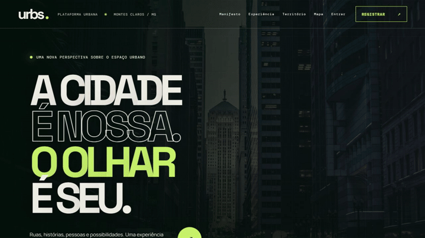

# URBS — Plataforma de Monitoramento Colaborativo Urbano

Protótipo acadêmico de uma plataforma para observar, registrar e visualizar questões de infraestrutura urbana. A área piloto apresentada é Montes Claros (MG).

[Abrir o protótipo navegável](https://raw.githack.com/sauloz20/urbs/main/public/index.html)

A demonstração abre a branch `main`. Na primeira visita, selecione **Open the page**. Explore a página inicial, o mapa e o formulário de nova ocorrência.



## Funcionalidades e limitações

- Apresentação do projeto, experiências visuais e mapa com filtros e ocorrências fictícias.
- Formulário de ocorrência com armazenamento no `localStorage` do navegador: os registros permanecem no dispositivo e não são enviados a um serviço público.
- Tela de acesso demonstrativa, sem contas reais ou autenticação por backend.
- Algumas imagens, fontes, mapas e bibliotecas são carregados de serviços externos e dependem de conexão.

## Tecnologias

HTML, CSS e JavaScript no navegador; Leaflet para o mapa; GSAP, PixiJS e Three.js em experiências visuais; CesiumJS em recursos geográficos. Não há etapa de compilação obrigatória para servir a pasta `public/`.

## Requisitos

- Navegador moderno com JavaScript habilitado.
- Servidor HTTP estático, como Apache/XAMPP, ou Python 3 para o comando abaixo.
- Conexão à internet para os recursos externos.

## Instalação e execução

Clone o repositório e entre na pasta:

```sh
git clone https://github.com/sauloz20/urbs.git
cd urbs
```

Com Python 3 instalado, inicie um servidor:

```sh
python -m http.server 8000 --directory public
```

Acesse `http://localhost:8000/`. Como alternativa, copie o conteúdo de `public/` para uma pasta servida pelo Apache/XAMPP e acesse a URL correspondente.

## Configuração geográfica

`public/assets/js/geo-config.js` contém configurações opcionais para recursos 3D. As chaves usadas no navegador ficam públicas: restrinja-as por domínio e API no provedor e não inclua credenciais de servidor. O uso de determinados serviços pode exigir faturamento e atribuição.

## Estrutura

```text
public/
  index.html, mapa.html, registro.html, login.html
  assets/
    css/       Estilos
    js/        Interações e dados locais
    images/    Imagens
    media/     Vídeo
    textures/  Texturas das experiências 3D
docs/
  desenvolvimento/  Materiais de desenvolvimento
  historico/        Registro das versões
  portfolio/        Demonstração visual
app.config.ts        Configuração adicional do projeto
```

## Imagens e contexto

O comparador de transformações usa registros publicados por órgãos públicos de outros municípios: eles não representam obras da URBS ou de Montes Claros. As fotos são hospedadas externamente. As imagens da seção **Do Olhar à Ação** são ilustrativas, geradas digitalmente e armazenadas no projeto.
